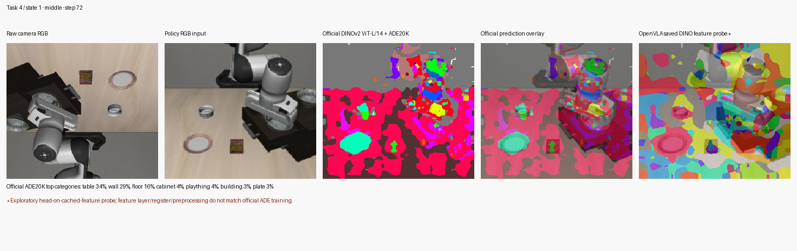
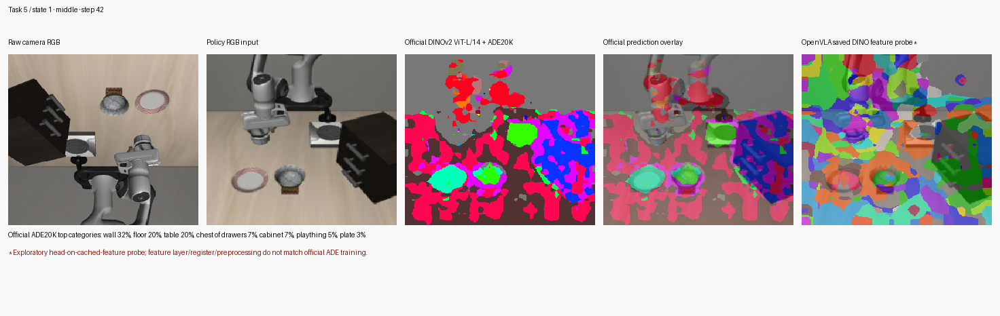
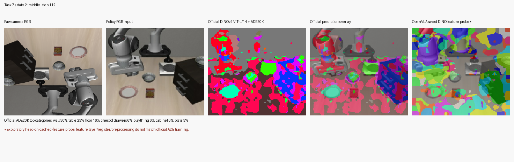

# DINOv2 ADE20K segmentation visual comparison on LIBERO

## What was compared

Yes: this trial ran the ADE20K head through **two feature paths** on the same 27 saved observations (tasks 4, 5, 7; states 0–2; early/middle/late frames).

1. **Official pretrained DINOv2 ViT-L/14 + ADE20K head.** The register-free Meta DINOv2-L/14 checkpoint was pinned to revision `0ff9d1340c9524c60f3f03e8573c57a1f8197f24`. It uses final normalized patch features and the official 150-class ADE20K linear head.
2. **OpenVLA cached DINO features + the same ADE20K head, as a compatibility probe.** This reused saved Track B feature tensors, so it did not run another vision encoder. It is **not** a checkpoint-matched OpenVLA segmentation model: OpenVLA uses a register-4 DINOv2 variant and cached block-22 features without the final normalization expected by the ADE head. Treat this second column as a mismatch diagnostic, not a valid segmentation comparison.

Both panels below show the raw camera image, OpenVLA policy-oriented RGB input, official ADE20K prediction and overlay, and the exploratory OpenVLA-feature probe. The probe's visibly scattered result is expected to be unreliable given the feature mismatch.

## Representative comparison panels

### Task 4, state 1, middle frame (step 72)



### Task 5, state 1, middle frame (step 42)



### Task 7, state 2, middle frame (step 112)



[Open the 3×3 task/state overview](global_overview.png) or browse the [nine three-frame contact sheets](contact_sheets/).

## Main visual findings

The official ADE20K path consistently recognizes broad scene regions such as table, wall, floor and cabinet. It does not reliably isolate the robot/gripper or small manipulation props. Those regions are often divided among generic labels such as table, floor, plaything, plate and tray. The taxonomy has no dedicated robot/gripper class and limited coverage for LIBERO's small objects.

The OpenVLA-feature probe is more fragmented, but it cannot establish that OpenVLA's fine-tuned vision features are inherently worse: the ADE head was trained for a different DINOv2 variant, feature layer, normalization and preprocessing.

**Conclusion:** the official ADE20K output is useful for broad scene visualization, but these results do not validate it as a manipulation foreground/background mask. The OpenVLA probe is inconclusive as a segmentation-quality test.

## Runtime and provenance

- 27 saved images; no environment replay, policy inference, oracle mask use, or KV-cache changes.
- Image-to-label path (preprocessing, transfer, DINOv2, ADE head and label decoding): median 112.49 ms, mean 116.80 ms, p95 132.35 ms after model load and one warm-up.
- Head only, features already on GPU: 1.05 ms for official final features; 0.26 ms for cached OpenVLA features.
- Peak CUDA memory reported by the run: 784 MiB.
- Official ADE20K head SHA-256: `59137f319d7e83c79f3253ab7bf63041f1f884e54ba865a2c7ef0046655306a0`.
- Official backbone SHA-256: `399fba97a95f22c36834418bc69373364a99af3a1153da1c0fb31db567c92e23`.

The exact frame provenance is in [frame_manifest.csv](frame_manifest.csv); model and preprocessing details are in [configuration.json](configuration.json); machine-readable run metrics are in [summary.json](summary.json).

## Reproduction

From the OpenVLA repository root, with the saved Track B dataset and the existing `openvla-cached:latest` container:

```bash
python experiments/kv_cache/experiments/trackb_dinov2_ade20k_visual_trial.py
```

To regenerate contact sheets and the overview from saved predictions without model inference:

```bash
python experiments/kv_cache/experiments/trackb_dinov2_ade20k_visual_trial.py --render-only
```
