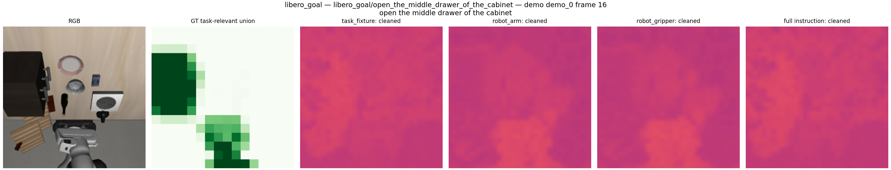
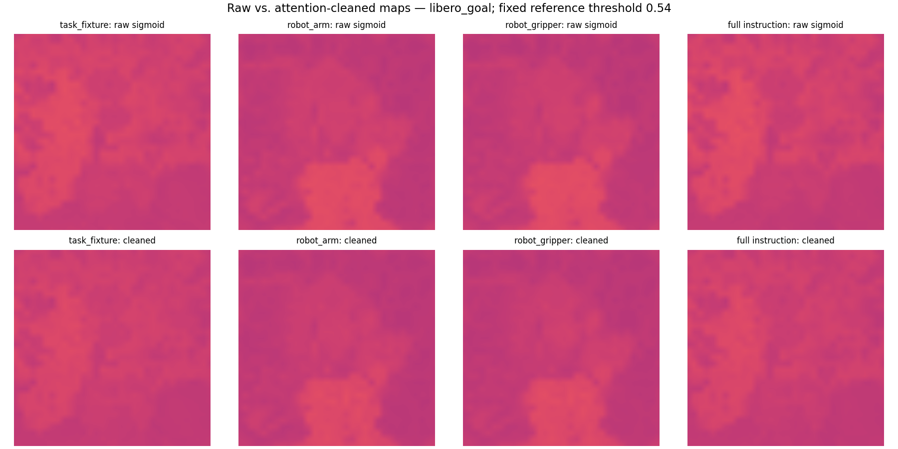
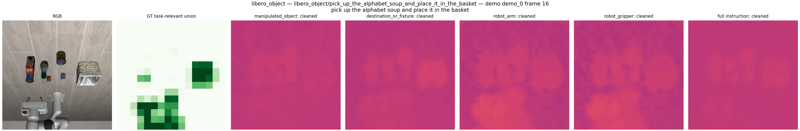
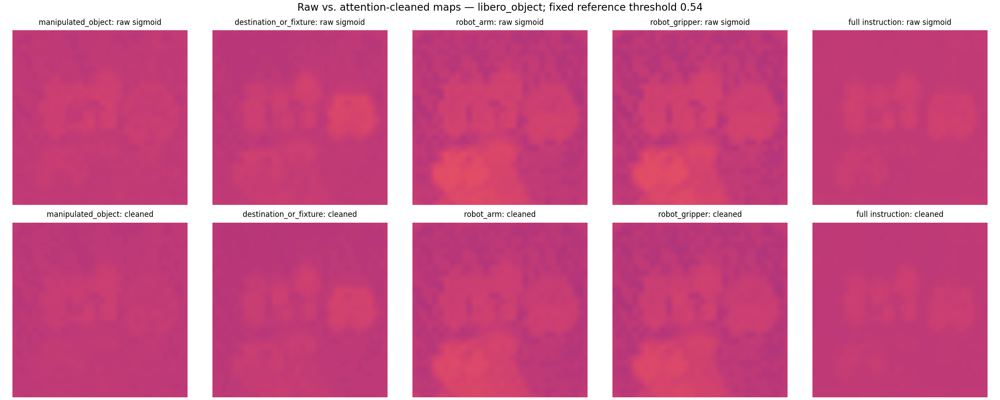
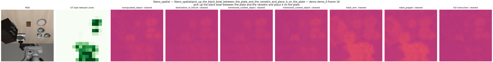
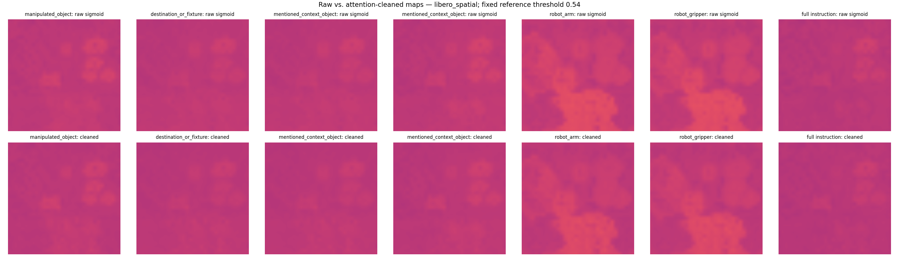

# Original Talk2DINO baseline validation

This report evaluates the frozen upstream Talk2DINO ViT-Large model and compares it with the already completed native OpenVLA DINO conditions. No training or policy rollout was performed.

## COCO Object val2017 — official 81-class semantic metric

The evaluator uses the upstream DINOText model functions (Talk2DINO revision `6dac47dbe3500df63f3b3df20dd28334290919cc`), official Meta DINOv2 ViT-L/14-register weights, OpenAI CLIP ViT-B/16 text weights and original Talk2DINO projection weights. It follows the upstream square 448 transform, 448 crops / 224 stride, `sub_imagenet_template`, 0.54 background score and global 81-class confusion matrix. Compatible MMCV/MMseg packages were unavailable for this Python/Torch runtime, so their slide wrapper and confusion accumulation were implemented as a single-process equivalent. The checkpoint hashes were verified. See `coco_object/configuration.json` for versions and hashes.

| Condition | mIoU incl. BG | Foreground mIoU | BG IoU | Published reference | Δ |
|---|---:|---:|---:|---:|---:|
| Official cleaned, no PAMR | 39.14% | 38.69% | 75.61% | 37.60% | +1.54 pp |
| Official cleaned + PAMR | 44.06% | 43.63% | 78.35% | 42.30% | +1.76 pp |
| Raw similarity, no cleaning | 34.98% | 34.57% | 67.43% | — | — |

Images evaluated: 5000 / 5000. The published 37.6% and 42.3% values are reference figures, not measurements from this run. Both measured deltas exceed the predeclared 1 pp tolerance; this is a near-protocol reproduction, not yet a validated exact reproduction.

## LIBERO saved-frame generalization

Official Talk2DINO was scored offline on 1152 paired frames from 36 existing E2 demonstration segments. This uses no policy actions. Inputs are existing 224×224 RGB frames, resized internally by upstream DINOText to 448×448. Threshold 0.54 is the official COCO setting and was not calibrated for LIBERO.

| Prompt role | Raw precision | Raw recall | Raw IoU | Clean precision | Clean recall | Clean IoU |
|---|---:|---:|---:|---:|---:|---:|
| destination_or_fixture | 15.06% | 90.92% | 14.84% | 21.21% | 81.60% | 20.25% |
| manipulated_object | 5.26% | 87.31% | 5.22% | 7.20% | 72.82% | 7.01% |
| robot_arm | 17.62% | 99.95% | 17.62% | 20.75% | 99.82% | 20.74% |
| robot_gripper | 5.07% | 99.98% | 5.07% | 6.01% | 99.95% | 6.01% |
| task_fixture | 15.98% | 99.88% | 15.98% | 19.60% | 98.09% | 19.53% |
| task_relevant_foreground | 33.98% | 37.88% | 21.82% | 35.35% | 27.69% | 18.38% |

### Existing same-frame native conditions (context only)

The following are previously measured Conditions A/B from the E2 native integration study; they are not recomputed in this run and must not be called an isolated implementation comparison.

| Condition | Task-relevant union IoU | Manipulated-object recall | Destination-object recall |
|---|---:|---:|---:|
| C3: official Meta DINO + custom E2 scoring | 31.43% | 49.75% | 67.58% |
| C4: OpenVLA DINO + custom E2 scoring | 37.14% | 4.60% | 43.35% |

## Runtime

COCO processing averaged 5.44 s/image (median 4.98, p95 7.28) across the three score outputs; peak CUDA allocated memory was 11.33 GB. This is per-image evaluator time in the current Orin container, not a comparison with independently optimized MMSegmentation. LIBERO frame latency and peak memory were not instrumented separately.

## Representative LIBERO maps

These deterministic mid-sequence examples are illustrative, not selected by model performance. Ground truth is shown at the 16×16 E2 patch grid; Talk2DINO maps are generated at 448×448 and aligned to the 224×224 image. The fixed 0.54 threshold is the COCO reference setting, not a LIBERO-calibrated operating point.

### libero_goal — open the middle drawer of the cabinet

### libero_object — pick up the alphabet soup and place it in the basket

### libero_spatial — pick up the black bowl between the plate and the ramekin and place it on the plate

## Interpretation and limitations

- COCO Object mIoU is a dataset-level semantic metric including background; it is not directly comparable to LIBERO role-wise fractional patch metrics.
- LIBERO evaluation reuses the previously inspected E2 frame/mask set; it is not an untouched test set and not a closed-loop task-success result.
- Two provisional LIBERO outputs were invalidated: the first had segment-cache basename collisions; the second used an empty role_gt channel instead of E2's separate relevant_gt union mask for the full-instruction query. Final results in `libero_final/` use task-relative segment paths and the correct relevant_gt label. Earlier `libero/` and `libero_corrected/` directories are audit trails and must not be cited.
- The native E2 comparison changed both the DINO weights/features and the inference implementation; it does not isolate domain shift or one pipeline component.
- COCO image-mask counts, 81-class mapping and checkpoint hashes were checked. All classes had nonempty unions. Both published mIoU differences exceed 1 pp; exact reproduction is unresolved. The remaining difference may involve evaluation-wrapper or preprocessing details; it must be checked under a compatible upstream MMSeg runtime before calling this an exact reproduction.
- Separate 224-pixel COCO, OpenVLA-preprocessing, raw+PAMR, threshold PR-curve and controlled custom-vs-official inference ablations were not run. LIBERO uses upstream resizing from cached 224 RGB frames; no alternate preprocessing condition was tested.
- LIBERO prompt queries use the E2-derived role phrases plus a full-instruction query. A separate bare-name vs. descriptive-phrase vs. full-instruction ablation was not run. Context-object prompts without individually reliable labels are visualized but excluded from role metrics.
- The five-image COCO smoke passed; the complete 5,000-image COCO run and corrected 1,152-frame LIBERO run completed. The first two provisional LIBERO aggregates were invalidated and retained only as audit trails.
- Checkpoint/configuration, preprocessing, class mapping, exact model calls, COCO timing and memory are recorded in machine-readable artifacts. LIBERO-specific timing and peak memory were not recorded.
- Do not recommend KV reuse from foreground recall alone. Background false negatives, role-specific object failures, temporal behavior and cache-policy task success require separate evidence.

## Artifacts

- COCO summary: `coco_object/summary.json`; per-class metrics: `coco_object/per_category_metrics.csv`.
- COCO global confusion matrices: `coco_object/confusion_*.npy`.
- Final corrected LIBERO per-frame/role metrics: `libero_final/per_frame_metrics.csv`; summary: `libero_final/summary.json`.
- Process status/logs: `coco_object/RUN_STATUS.json`, `libero_final/RUN_STATUS.json`, `coco_object/logs/talk2dino-coco.log`.
