# Talk2DINO LIBERO binary-mask gallery

Individual-query visualizations for all 12 tasks represented in the completed LIBERO scoring cache. These are saved RGB observations and cached official standalone Talk2DINO predictions; no inference or rollout was run to make this gallery.

## How to read the panels

Each panel shows RGB, oracle foreground, predicted foreground, predicted background, and a color-coded error overlay. Green is a correctly selected foreground patch (TP), red is a false-positive foreground patch (FP), and yellow is missed foreground (FN). Metrics use binary 16×16 patches: oracle occupancy > 0, prediction is the cached attention-cleaned score ≥ 0.54, and invalid tokens are excluded. Each patch is enlarged to a 14×14 pixel block on the 224×224 RGB image; this is not pixel-boundary segmentation.

Frames were selected per task and query by median positive oracle patch area, without inspecting model scores or predictions. The selected queries are manipulated objects, destination/fixtures, or the task fixture when no object query is available.

## Examples

### libero_goal — `open_the_middle_drawer_of_the_cabinet`

**Query:** middle drawer of the cabinet (task_fixture) · **Demo/frame:** demo_0 / 11 · **P/R/IoU:** 0.255 / 1.000 / 0.255 · **FG/BG coverage:** 76.6% / 23.4%

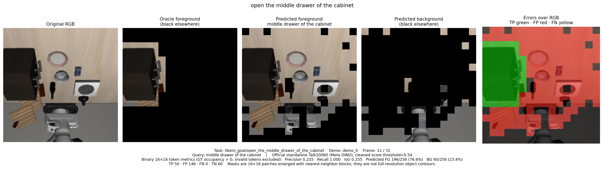

### libero_goal — `open_the_top_drawer_and_put_the_bowl_inside`

**Query:** top drawer (task_fixture) · **Demo/frame:** demo_10 / 16 · **P/R/IoU:** 0.374 / 0.938 / 0.365 · **FG/BG coverage:** 63.7% / 36.3%

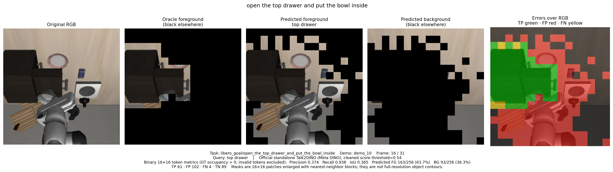

### libero_goal — `put_the_bowl_on_the_plate`

**Query:** bowl (manipulated_object) · **Demo/frame:** demo_10 / 9 · **P/R/IoU:** 0.125 / 0.429 / 0.107 · **FG/BG coverage:** 9.4% / 90.6%

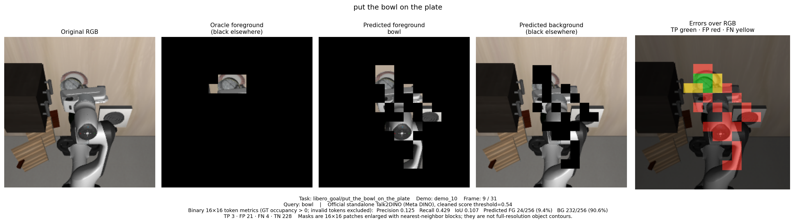

### libero_goal — `put_the_bowl_on_the_plate`

**Query:** plate (destination_or_fixture) · **Demo/frame:** demo_0 / 15 · **P/R/IoU:** 0.545 / 0.600 / 0.400 · **FG/BG coverage:** 4.3% / 95.7%

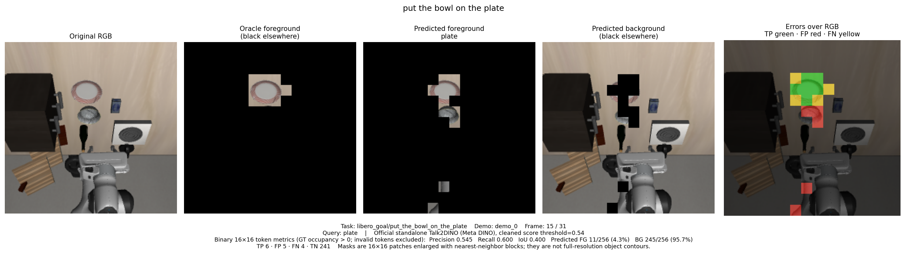

### libero_goal — `put_the_wine_bottle_on_the_rack`

**Query:** bottle (manipulated_object) · **Demo/frame:** demo_0 / 17 · **P/R/IoU:** 0.161 / 0.625 / 0.147 · **FG/BG coverage:** 12.1% / 87.9%

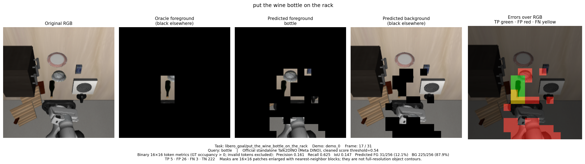

### libero_goal — `put_the_wine_bottle_on_the_rack`

**Query:** rack (destination_or_fixture) · **Demo/frame:** demo_1 / 22 · **P/R/IoU:** 0.176 / 0.885 / 0.172 · **FG/BG coverage:** 51.2% / 48.8%

### libero_goal — `put_the_wine_bottle_on_the_rack`

**Query:** rack (task_fixture) · **Demo/frame:** demo_1 / 22 · **P/R/IoU:** 0.176 / 0.885 / 0.172 · **FG/BG coverage:** 51.2% / 48.8%

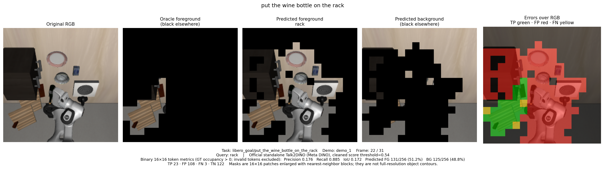

### libero_object — `pick_up_the_alphabet_soup_and_place_it_in_the_basket`

**Query:** alphabet soup (manipulated_object) · **Demo/frame:** demo_0 / 13 · **P/R/IoU:** 0.000 / 0.000 / 0.000 · **FG/BG coverage:** 4.7% / 95.3%

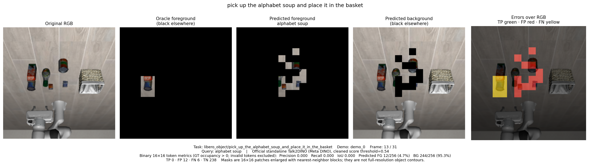

### libero_object — `pick_up_the_alphabet_soup_and_place_it_in_the_basket`

**Query:** basket (destination_or_fixture) · **Demo/frame:** demo_0 / 15 · **P/R/IoU:** 0.409 / 0.900 / 0.391 · **FG/BG coverage:** 17.2% / 82.8%

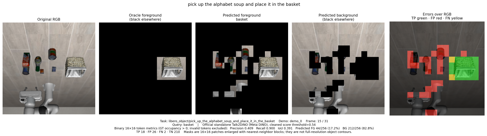

### libero_object — `pick_up_the_butter_and_place_it_in_the_basket`

**Query:** butter (manipulated_object) · **Demo/frame:** demo_1 / 8 · **P/R/IoU:** 0.080 / 1.000 / 0.080 · **FG/BG coverage:** 19.5% / 80.5%

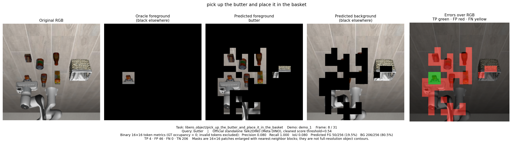

### libero_object — `pick_up_the_butter_and_place_it_in_the_basket`

**Query:** basket (destination_or_fixture) · **Demo/frame:** demo_1 / 4 · **P/R/IoU:** 0.383 / 0.783 / 0.346 · **FG/BG coverage:** 18.4% / 81.6%

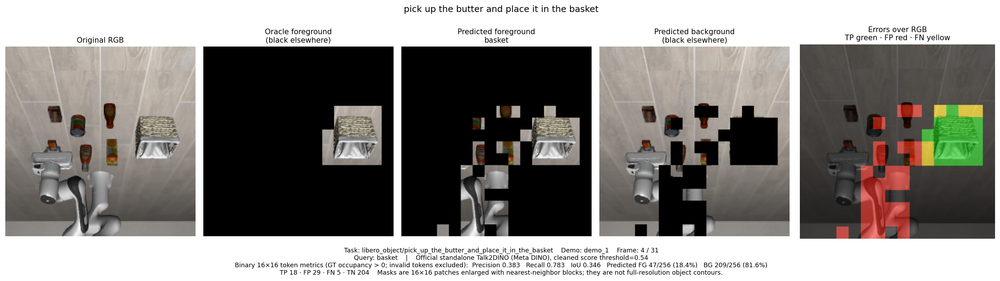

### libero_object — `pick_up_the_salad_dressing_and_place_it_in_the_basket`

**Query:** salad dressing (manipulated_object) · **Demo/frame:** demo_0 / 17 · **P/R/IoU:** 0.304 / 0.875 / 0.292 · **FG/BG coverage:** 9.0% / 91.0%

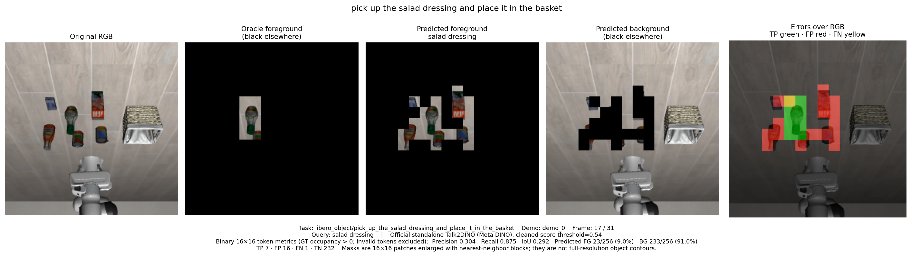

### libero_object — `pick_up_the_salad_dressing_and_place_it_in_the_basket`

**Query:** basket (destination_or_fixture) · **Demo/frame:** demo_1 / 17 · **P/R/IoU:** 0.400 / 1.000 / 0.400 · **FG/BG coverage:** 15.6% / 84.4%

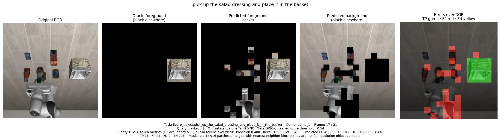

### libero_object — `pick_up_the_tomato_sauce_and_place_it_in_the_basket`

**Query:** tomato sauce (manipulated_object) · **Demo/frame:** demo_10 / 8 · **P/R/IoU:** 0.100 / 0.167 / 0.067 · **FG/BG coverage:** 3.9% / 96.1%

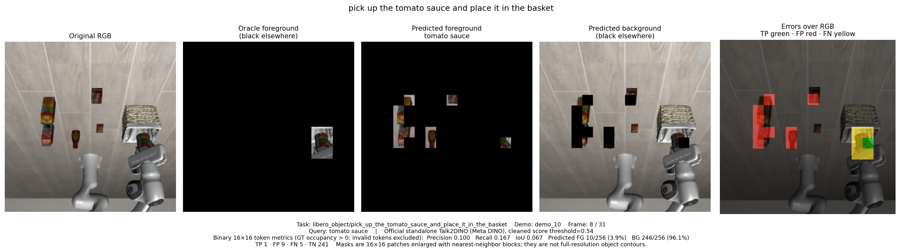

### libero_object — `pick_up_the_tomato_sauce_and_place_it_in_the_basket`

**Query:** basket (destination_or_fixture) · **Demo/frame:** demo_0 / 15 · **P/R/IoU:** 0.296 / 1.000 / 0.296 · **FG/BG coverage:** 21.1% / 78.9%

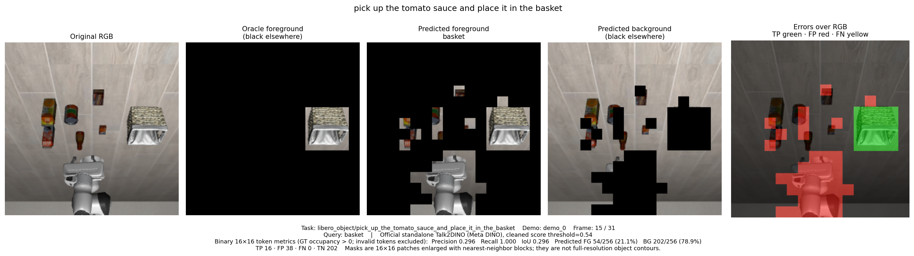

### libero_spatial — `pick_up_the_black_bowl_between_the_plate_and_the_ramekin_and_place_it_on_the_plate`

**Query:** bowl (manipulated_object) · **Demo/frame:** demo_10 / 17 · **P/R/IoU:** 0.154 / 0.250 / 0.105 · **FG/BG coverage:** 5.1% / 94.9%

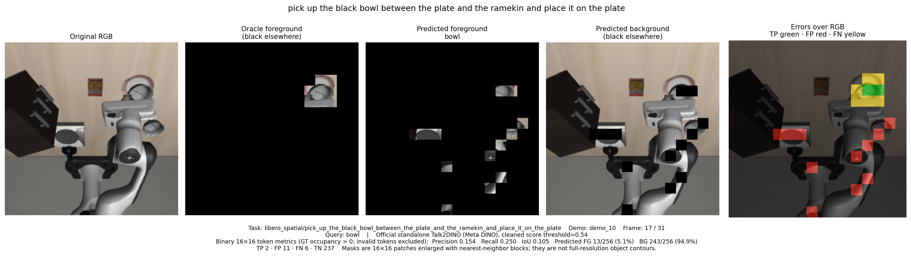

### libero_spatial — `pick_up_the_black_bowl_between_the_plate_and_the_ramekin_and_place_it_on_the_plate`

**Query:** plate (destination_or_fixture) · **Demo/frame:** demo_1 / 25 · **P/R/IoU:** 0.000 / 0.000 / 0.000 · **FG/BG coverage:** 0.4% / 99.6%

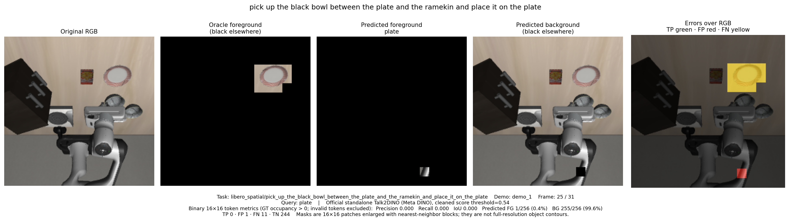

### libero_spatial — `pick_up_the_black_bowl_from_table_center_and_place_it_on_the_plate`

**Query:** bowl (manipulated_object) · **Demo/frame:** demo_10 / 15 · **P/R/IoU:** 0.000 / 0.000 / 0.000 · **FG/BG coverage:** 1.2% / 98.8%

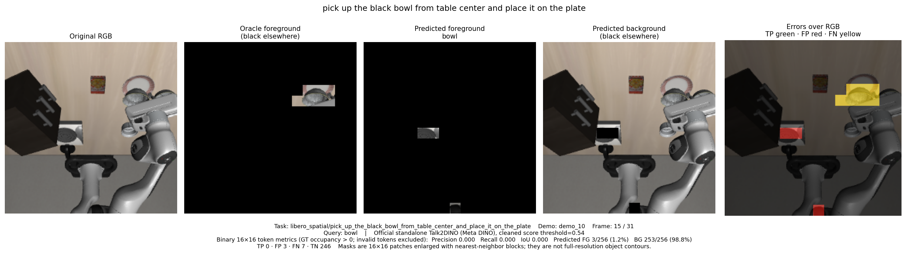

### libero_spatial — `pick_up_the_black_bowl_from_table_center_and_place_it_on_the_plate`

**Query:** plate (destination_or_fixture) · **Demo/frame:** demo_1 / 23 · **P/R/IoU:** 0.000 / 0.000 / 0.000 · **FG/BG coverage:** 0.0% / 100.0%

### libero_spatial — `pick_up_the_black_bowl_in_the_top_drawer_of_the_wooden_cabinet_and_place_it_on_the_plate`

**Query:** bowl (manipulated_object) · **Demo/frame:** demo_0 / 2 · **P/R/IoU:** 0.400 / 0.364 / 0.235 · **FG/BG coverage:** 3.9% / 96.1%

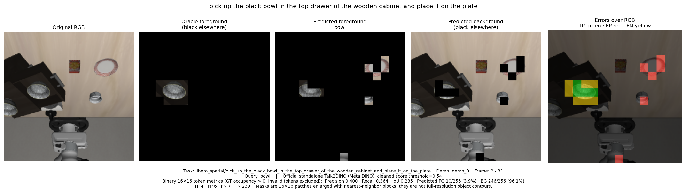

### libero_spatial — `pick_up_the_black_bowl_in_the_top_drawer_of_the_wooden_cabinet_and_place_it_on_the_plate`

**Query:** plate (destination_or_fixture) · **Demo/frame:** demo_0 / 16 · **P/R/IoU:** 0.000 / 0.000 / 0.000 · **FG/BG coverage:** 0.0% / 100.0%

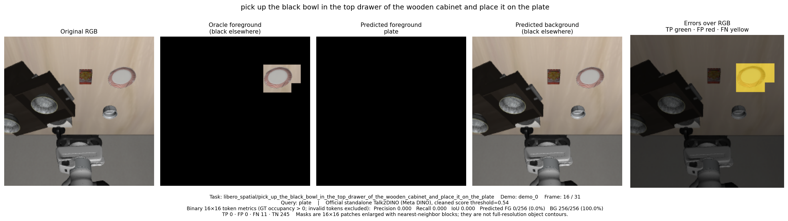

### libero_spatial — `pick_up_the_black_bowl_on_the_stove_and_place_it_on_the_plate`

**Query:** bowl (manipulated_object) · **Demo/frame:** demo_1 / 15 · **P/R/IoU:** 0.222 / 0.250 / 0.133 · **FG/BG coverage:** 3.5% / 96.5%

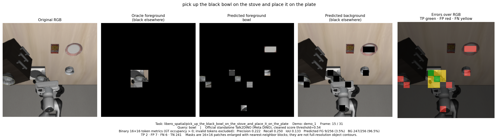

### libero_spatial — `pick_up_the_black_bowl_on_the_stove_and_place_it_on_the_plate`

**Query:** plate (destination_or_fixture) · **Demo/frame:** demo_0 / 17 · **P/R/IoU:** 0.000 / 0.000 / 0.000 · **FG/BG coverage:** 0.0% / 100.0%

