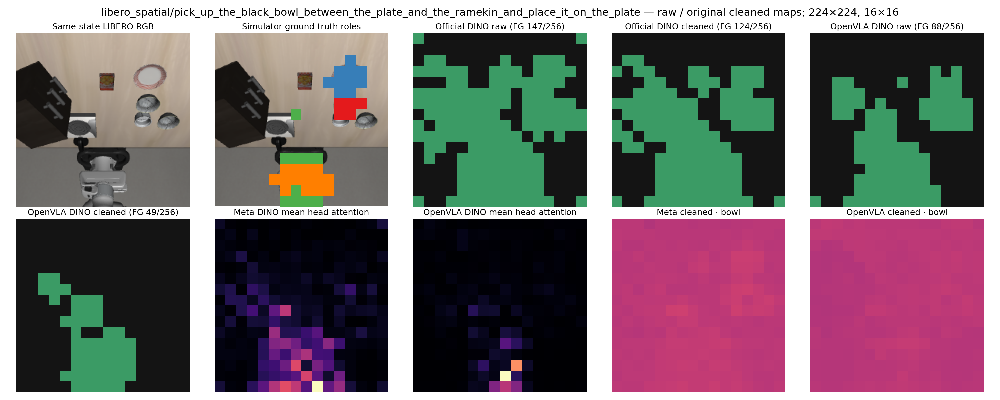
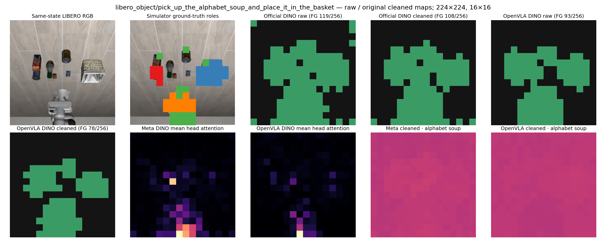
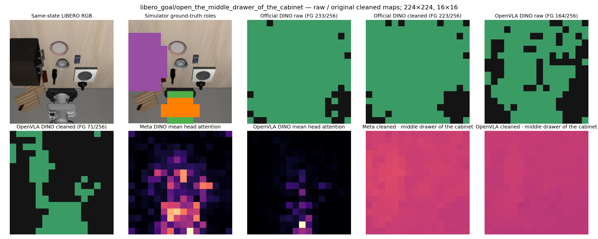
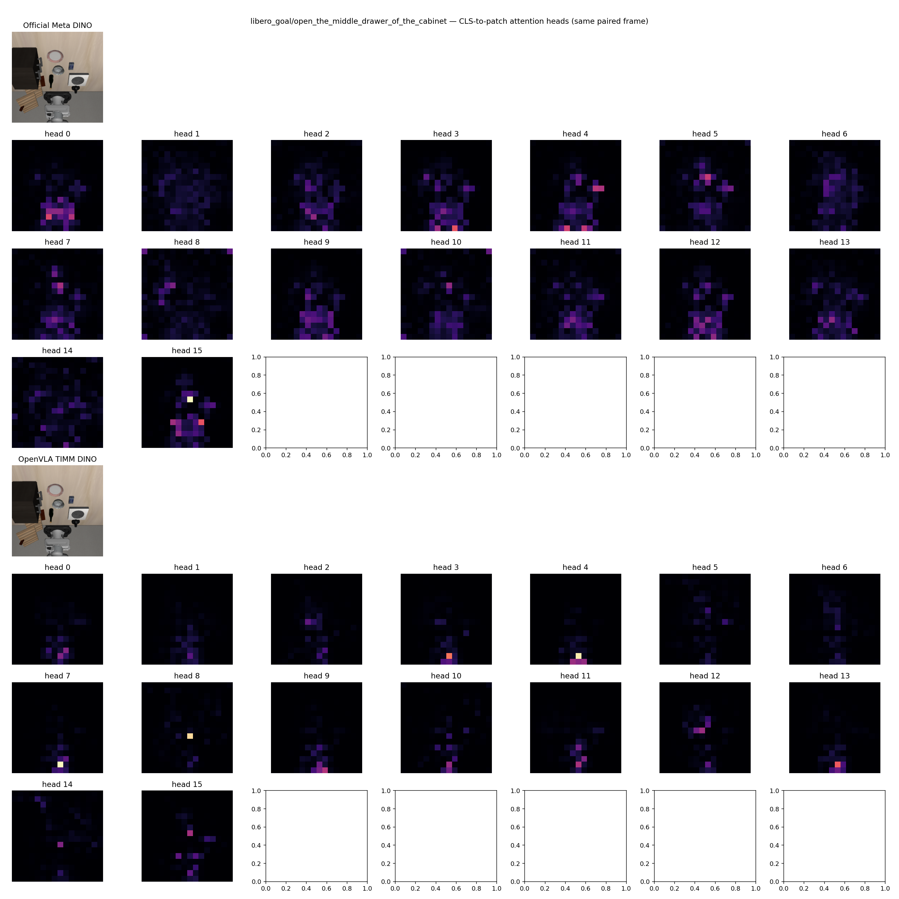
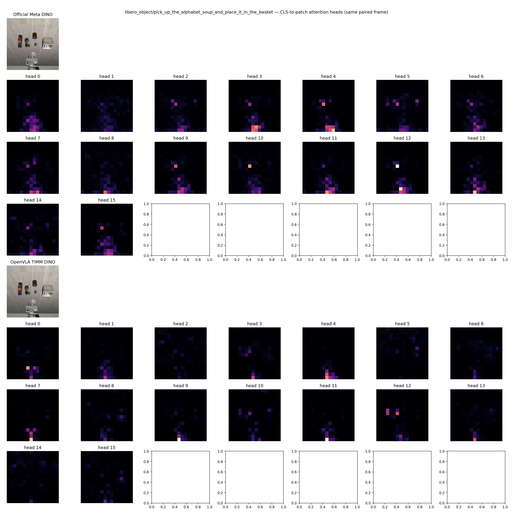
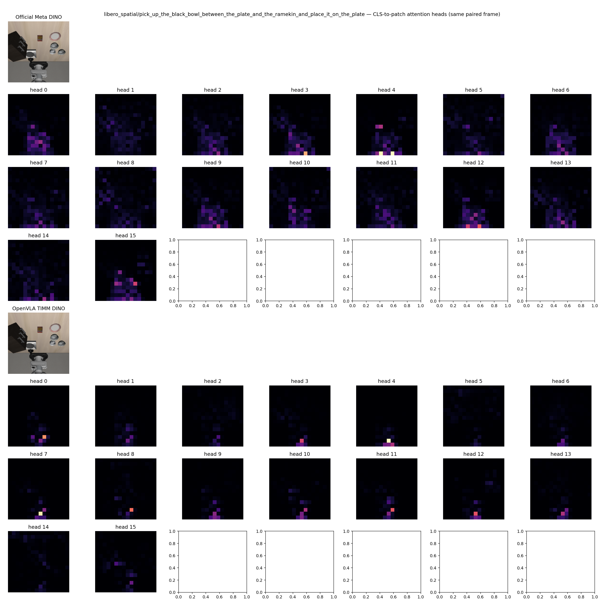

# Native Talk2DINO Integration into OpenVLA

## Run status

- Mode: E2 evaluation
- Paired frames scored: 1152
- Sequences represented: 36
- Evaluation complete: True
- E2 task/frame inventory: 12 tasks, 1152 frames

## Method and compatibility

Condition A uses official Meta DINOv2 ViT-L/14-register weights; Condition B captures Talk2DINO outputs from the already-loaded OpenVLA TIMM DINO path. Both use the same OpenAI CLIP ViT-B/16 text tower and frozen official Talk2DINO MLP.
The seven upstream prompt templates are averaged in raw CLIP embedding space before projection. OpenAI CLIP is loaded as a text-only tower; its text keys load strictly after removing only archive metadata and the unused visual/logit-scale keys. EOT id 49407 is checked by the OpenCLIP ViT-B/16 tokenizer. The projection MLP is loaded strictly and frozen.
Both comparison backbones receive the identical OpenVLA DINO pixel tensor at 224×224. The installed upstream Meta transform differed from that tensor by max absolute normalized-pixel value 0.00810981; this discrepancy is recorded rather than hidden. Thus the A/B comparison is controlled for identical pixels, but it does not reproduce Meta's original transform as a separate standalone condition.
The OpenVLA DINO module is TIMM 0.9.16. Its get_intermediate_layers implementation continues executing all 24 transformer blocks while returning the requested block-23 features. Hooks capture the raw block-23 patch states used by OpenVLA and the already-computed block-24 token states/QKV. OpenVLA penultimate features are pre-final-LayerNorm; Talk2DINO final patch features apply the final LayerNorm. No DINO block or forward is executed a second time.

### Runtime identities

- OpenVLA checkpoint: `openvla/openvla-7b-finetuned-libero-spatial` (revision `962318cec55ac10993ff0f5f43eda9a270b4c873`).
- DINOv2 source revision: `7764ea0f912e53c92e82eb78a2a1631e92725fc8`; official checkpoint SHA-256 `36e4deffbaef061a2576705b0c36f93621e2ae20bf6274694821b0b492551b51`.
- OpenAI CLIP ViT-B/16 SHA-256: `5806e77cd80f8b59890b7e101eabd078d9fb84e6937f9e85e4ecb61988df416f`.
- Talk2DINO MLP SHA-256: `4e28d24ecb905592c902b04d9c077484346ebafac8547b968bd5af16291d8d69`.
- Observed backend: `sdpa`; Transformers `4.49.0` (the checkpoint's remote code warns that it was authored against Transformers 4.40.1 / tokenizers 0.19.1; installed runtime is retained at 4.49.0 / 0.21.0).
- Runtime feature dimensions: OpenVLA DINO penultimate `[1,256,1024]`; final patch sidecar `[1,256,1024]`; CLS-to-patch attention `[16,256]`; fused OpenVLA visual sequence `[1,256,2176]`.

## Timing

- Official DINO forward (A): median 26.997 ms.
- OpenVLA DINO normal pass with passive sidecar hooks (B): median 26.764 ms.
- Talk2DINO scoring: A median 2.080 ms; B median 1.812 ms.
Text is encoded once per task and its time is reported separately. Peak allocated GPU memory was 16169181184 bytes; peak reserved memory was 16231956480 bytes. These are component timings, not robot-policy end-to-end latency or an acceleration claim.

## Results

Role metrics are pooled fractional patch occupancy over valid E2 patches. The original 0.54 threshold is held fixed; no threshold is calibrated on the evaluated E2 frames.

| Model / processing | Role | Precision | Recall | Role IoU | Complement IoU |
|---|---|---:|---:|---:|---:|
| a_clean | background | 0.9968 | 0.5526 | 0.5516 | 0.3143 |
| a_clean | destination_objects | 0.2435 | 0.6758 | 0.2180 | 0.9458 |
| a_clean | manipulated_objects | 0.0627 | 0.4975 | 0.0590 | 0.9397 |
| a_clean | robot_arm | 0.1825 | 0.9986 | 0.1825 | 0.5815 |
| a_clean | robot_gripper | 0.0539 | 0.9987 | 0.0539 | 0.5778 |
| a_clean | task_relevant_fixtures | 0.1945 | 0.9833 | 0.1939 | 0.7431 |
| a_clean | task_relevant_foreground | 0.3152 | 0.9914 | 0.3143 | 0.5516 |
| a_raw | background | 0.9994 | 0.4658 | 0.4657 | 0.2796 |
| a_raw | destination_objects | 0.1799 | 0.7717 | 0.1708 | 0.9160 |
| a_raw | manipulated_objects | 0.0539 | 0.6340 | 0.0522 | 0.9125 |
| a_raw | robot_arm | 0.1598 | 0.9995 | 0.1598 | 0.5084 |
| a_raw | robot_gripper | 0.0468 | 0.9996 | 0.0468 | 0.5101 |
| a_raw | task_relevant_fixtures | 0.1646 | 0.9951 | 0.1645 | 0.6821 |
| a_raw | task_relevant_foreground | 0.2797 | 0.9987 | 0.2796 | 0.4657 |
| b_clean | background | 0.9144 | 0.8670 | 0.8019 | 0.3714 |
| b_clean | destination_objects | 0.7658 | 0.4335 | 0.3828 | 0.9844 |
| b_clean | manipulated_objects | 0.0868 | 0.0460 | 0.0310 | 0.9891 |
| b_clean | robot_arm | 0.3048 | 0.6993 | 0.2695 | 0.8275 |
| b_clean | robot_gripper | 0.1175 | 0.8061 | 0.1143 | 0.8502 |
| b_clean | task_relevant_fixtures | 0.2699 | 0.1430 | 0.1031 | 0.9258 |
| b_clean | task_relevant_foreground | 0.4876 | 0.6092 | 0.3714 | 0.8019 |
| b_raw | background | 0.9442 | 0.7196 | 0.6902 | 0.3385 |
| b_raw | destination_objects | 0.6323 | 0.6048 | 0.4474 | 0.9833 |
| b_raw | manipulated_objects | 0.1151 | 0.1402 | 0.0675 | 0.9853 |
| b_raw | robot_arm | 0.2304 | 0.8377 | 0.2205 | 0.7271 |
| b_raw | robot_gripper | 0.0752 | 0.8714 | 0.0744 | 0.7395 |
| b_raw | task_relevant_fixtures | 0.2621 | 0.5138 | 0.2100 | 0.8820 |
| b_raw | task_relevant_foreground | 0.3708 | 0.7954 | 0.3385 | 0.6902 |

## Limitations

The role-specific `IoU` column is the IoU for the named foreground role; `Complement IoU` is the IoU of its binary complement. For the `background` row, `Role IoU` is background IoU and `Complement IoU` is task-relevant foreground IoU. These fractional-occupancy pooled metrics are not the same as the E2 foreground-union metric when the role is `background`.
This is paired replay of the existing E2 demonstration states, not policy rollouts. It measures agreement with simulator role masks on a 16×16 grid. The standalone-versus-integrated comparison changes DINO checkpoint weights and implementation as a system; matched architecture names do not imply identical parameters. `backbone_compatibility.json` records parameter-level differences; results should not be interpreted as isolating fine-tuning alone. The inherited E2 split has previously been inspected and is not an untouched test set.
Engineering conclusion: the sidecar integration is feasible—the existing OpenVLA DINO forward supplies the needed final block and attention without a second DINO pass, and the action-parity smoke test was exact. Segmentation quality is mixed rather than sufficient for reliable manipulation-object grounding. Integrated B improves pooled cleaned task-relevant union IoU over standalone A (0.3714 vs 0.3143) and background IoU (0.8019 vs 0.5516), but its cleaned manipulated-object recall is only 0.0460 (A: 0.4975). Therefore this run does not establish acceptable target-object segmentation for manipulation, despite the favorable union/background metrics.

## Visual examples

Panels show RGB, simulator role masks, A/B raw and cleaned threshold masks, attention summaries, and one instruction-derived category map. The selection is the first sorted demonstration frame for each suite, not a performance-based selection.

### libero_spatial

### libero_object

### libero_goal

### 16-head attention detail

Per-frame values are in `per_frame_metrics.csv`; all generated panels are in `figures/`.
