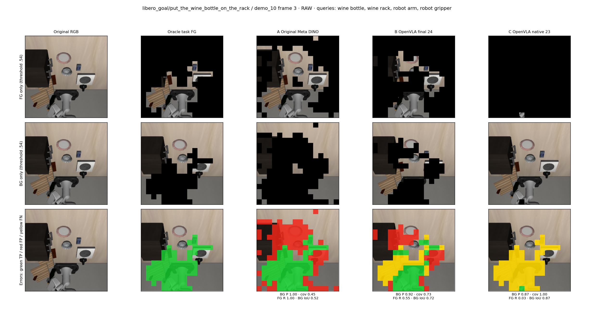
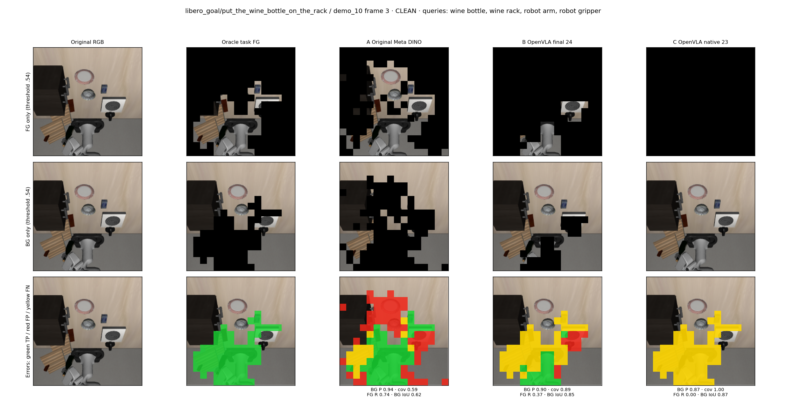
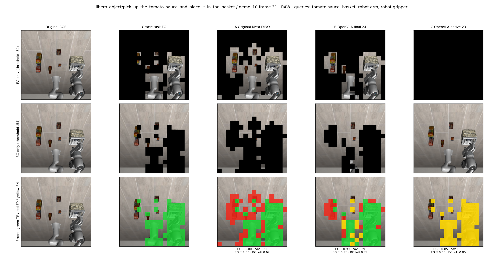
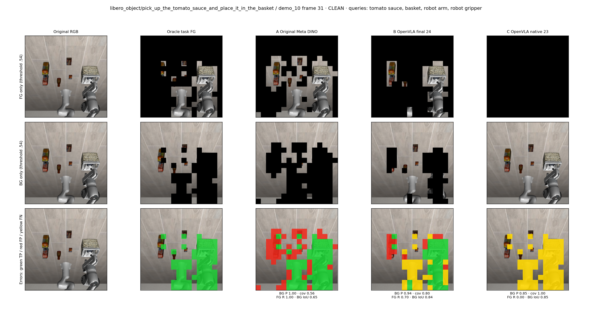
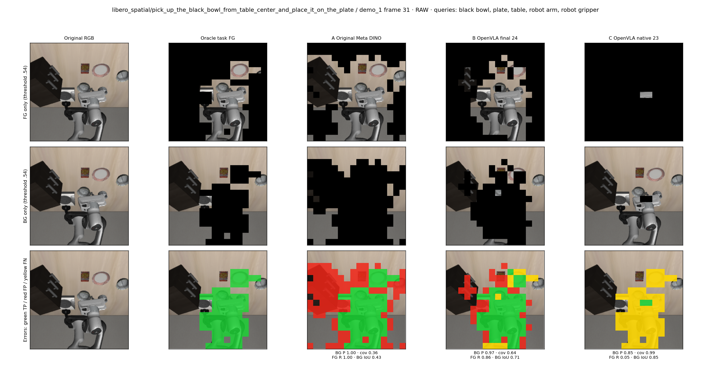
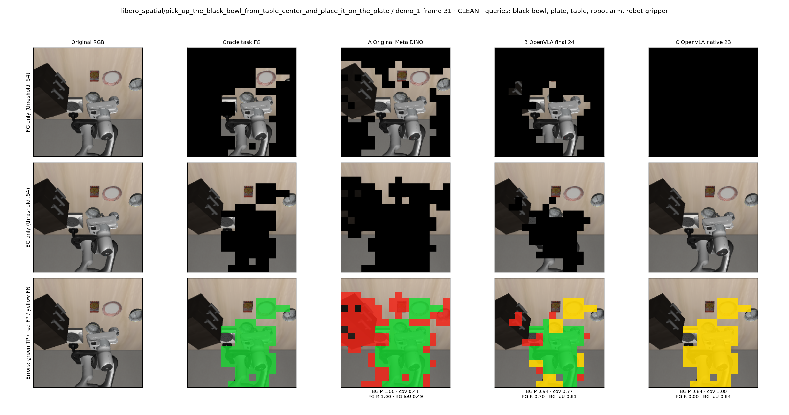

# Talk2DINO Background Detection with OpenVLA DINOv2 Weights

## Summary

This paired offline evaluation uses the same 90 saved E2 RGB frames, oracle patch masks, prompts and demonstration-level split as the completed original multi-category LIBERO experiment. No new demonstrations, policy rollouts, training or KV-cache changes were made. All main A/B/C comparisons use the tensor taken from the first three channels of OpenVLA’s own processor `pixel_values`. The prior saved A maps are retained only as a preprocessing/protocol audit; A is recomputed with matched pixels because the earlier standalone preprocessing is not byte-identical.

## Evaluation-set background/foreground metrics at the fixed 0.54 reference threshold

| Condition | Postprocess | FG precision | FG recall | FG IoU | BG precision | BG recall | BG IoU | BG coverage | Foreground missed as BG |
|---|---|---:|---:|---:|---:|---:|---:|---:|---:|
| A_original_meta_final24 | RAW | 0.280 | 0.997 | 0.279 | 0.999 | 0.535 | 0.534 | 45.3% | 0.3% |
| A_original_meta_final24 | CLEAN | 0.312 | 0.977 | 0.310 | 0.993 | 0.610 | 0.608 | 52.0% | 2.3% |
| B_openvla_final24 | RAW | 0.349 | 0.769 | 0.316 | 0.946 | 0.740 | 0.711 | 66.2% | 23.1% |
| B_openvla_final24 | CLEAN | 0.462 | 0.619 | 0.360 | 0.926 | 0.870 | 0.814 | 79.5% | 38.1% |
| C_openvla_native23 | RAW | 0.796 | 0.053 | 0.052 | 0.853 | 0.998 | 0.852 | 99.0% | 94.7% |
| C_openvla_native23 | CLEAN | 0.947 | 0.010 | 0.010 | 0.848 | 1.000 | 0.848 | 99.8% | 99.0% |

## Development-selected operating points, evaluated on the frozen 60-frame split

| Condition | Map | Dev target recall | Threshold | Dev FG recall | Dev BG IoU | Eval FG recall | Eval BG IoU | Eval BG coverage | Constraint met |
|---|---|---:|---:|---:|---:|---:|---:|---:|---|
| A_original_meta_final24 | RAW | 95% | 0.55 | 0.987 | 0.473 | 0.974 | 0.616 | 52.8% | True |
| A_original_meta_final24 | RAW | 98% | 0.55 | 0.987 | 0.473 | 0.974 | 0.616 | 52.8% | True |
| A_original_meta_final24 | CLEAN | 95% | 0.54 | 0.991 | 0.457 | 0.977 | 0.608 | 52.0% | True |
| A_original_meta_final24 | CLEAN | 98% | 0.54 | 0.991 | 0.457 | 0.977 | 0.608 | 52.0% | True |
| B_openvla_final24 | RAW | 95% | 0.50 | 1.000 | 0.000 | 1.000 | 0.000 | 0.0% | True |
| B_openvla_final24 | RAW | 98% | 0.50 | 1.000 | 0.000 | 1.000 | 0.000 | 0.0% | True |
| B_openvla_final24 | CLEAN | 95% | 0.50 | 1.000 | 0.000 | 1.000 | 0.000 | 0.0% | True |
| B_openvla_final24 | CLEAN | 98% | 0.50 | 1.000 | 0.000 | 1.000 | 0.000 | 0.0% | True |
| C_openvla_native23 | RAW | 95% | 0.50 | 1.000 | 0.002 | 0.997 | 0.004 | 0.4% | True |
| C_openvla_native23 | RAW | 98% | 0.50 | 1.000 | 0.002 | 0.997 | 0.004 | 0.4% | True |
| C_openvla_native23 | CLEAN | 95% | 0.50 | 1.000 | 0.005 | 0.991 | 0.025 | 2.3% | True |
| C_openvla_native23 | CLEAN | 98% | 0.50 | 1.000 | 0.005 | 0.991 | 0.025 | 2.3% | True |

## Object-role protection by the final multi-query mask at threshold 0.54

| Condition | Map | Role | Eval FG recall | Eval role IoU | Frames with visible role |
|---|---|---|---:|---:|---:|
| A_original_meta_final24 | RAW | manipulated_objects | 0.999 | 0.013 | 60 |
| A_original_meta_final24 | RAW | destination_objects | 0.999 | 0.049 | 50 |
| A_original_meta_final24 | RAW | task_relevant_fixtures | 0.953 | 0.082 | 10 |
| A_original_meta_final24 | RAW | robot_arm | 1.000 | 0.172 | 60 |
| A_original_meta_final24 | RAW | robot_gripper | 1.000 | 0.036 | 60 |
| A_original_meta_final24 | CLEAN | manipulated_objects | 0.989 | 0.014 | 60 |
| A_original_meta_final24 | CLEAN | destination_objects | 0.990 | 0.054 | 50 |
| A_original_meta_final24 | CLEAN | task_relevant_fixtures | 0.602 | 0.066 | 10 |
| A_original_meta_final24 | CLEAN | robot_arm | 0.999 | 0.195 | 60 |
| A_original_meta_final24 | CLEAN | robot_gripper | 1.000 | 0.041 | 60 |
| B_openvla_final24 | RAW | manipulated_objects | 0.880 | 0.018 | 60 |
| B_openvla_final24 | RAW | destination_objects | 0.763 | 0.061 | 50 |
| B_openvla_final24 | RAW | task_relevant_fixtures | 0.252 | 0.030 | 10 |
| B_openvla_final24 | RAW | robot_arm | 0.785 | 0.206 | 60 |
| B_openvla_final24 | RAW | robot_gripper | 0.988 | 0.057 | 60 |
| B_openvla_final24 | CLEAN | manipulated_objects | 0.708 | 0.023 | 60 |
| B_openvla_final24 | CLEAN | destination_objects | 0.664 | 0.082 | 50 |
| B_openvla_final24 | CLEAN | task_relevant_fixtures | 0.093 | 0.019 | 10 |
| B_openvla_final24 | CLEAN | robot_arm | 0.626 | 0.244 | 60 |
| B_openvla_final24 | CLEAN | robot_gripper | 0.939 | 0.089 | 60 |
| C_openvla_native23 | RAW | manipulated_objects | 0.011 | 0.004 | 60 |
| C_openvla_native23 | RAW | destination_objects | 0.062 | 0.045 | 50 |
| C_openvla_native23 | RAW | task_relevant_fixtures | 0.000 | 0.000 | 10 |
| C_openvla_native23 | RAW | robot_arm | 0.049 | 0.046 | 60 |
| C_openvla_native23 | RAW | robot_gripper | 0.137 | 0.099 | 60 |
| C_openvla_native23 | CLEAN | manipulated_objects | 0.001 | 0.001 | 60 |
| C_openvla_native23 | CLEAN | destination_objects | 0.000 | 0.000 | 50 |
| C_openvla_native23 | CLEAN | task_relevant_fixtures | 0.000 | 0.000 | 10 |
| C_openvla_native23 | CLEAN | robot_arm | 0.009 | 0.009 | 60 |
| C_openvla_native23 | CLEAN | robot_gripper | 0.039 | 0.037 | 60 |

## Checkpoint, feature and preprocessing compatibility

- OpenVLA fine-tuned checkpoint revision: `962318cec55ac10993ff0f5f43eda9a270b4c873`; model `openvla/openvla-7b-finetuned-libero-spatial`.
- OpenVLA DINO identifier: `vit_large_patch14_reg4_dinov2.lvd142m`; 24 blocks, 4 registers, 1024 width, 16 heads.
- Original Meta DINO weights SHA-256: `36e4deffbaef061a2576705b0c36f93621e2ae20bf6274694821b0b492551b51`; source revision `7764ea0f912e53c92e82eb78a2a1631e92725fc8`.
- CLIP text tower SHA-256: `5806e77cd80f8b59890b7e101eabd078d9fb84e6937f9e85e4ecb61988df416f`; MLP SHA-256: `4e28d24ecb905592c902b04d9c077484346ebafac8547b968bd5af16291d8d69`.
- Frozen Talk2DINO projection source revision: `6dac47dbe3500df63f3b3df20dd28334290919cc`.
- OpenVLA versus Meta parameter audit: 294 same-name/same-shape tensors compared; 14 are exactly equal after BF16 casting. The fine-tuned checkpoint is not being mistaken for Meta initialization.
- Runtime: PyTorch `2.6.0`, CUDA `12.8`, TIMM `0.9.16`, Transformers `4.49.0`, attention backend `sdpa` on `Orin`. OpenVLA remote code warns it expects Transformers 4.40.1, while this validated container has 4.49.0; exact action parity and all feature/shape checks passed here, but this runtime-version difference remains a reproducibility caveat.
- B uses the same OpenVLA DINO pass to capture block 23, block 24, final block QKV and final LayerNorm patch states. C uses block-23 patch states and block-23 CLS-to-patch QKV attention. CLS and four register keys are excluded from the 256 spatial positions.
- All matched conditions use `processor.image_processor(...)["pixel_values"][:, :3]` at 224×224. Mean/max absolute pixel difference from the official standalone Meta-DINO transform was 0.015625/0.015625. The earlier saved A maps used standalone DINOText preprocessing; score-map agreement is quantified in `summary.json` and those maps are not treated as pixel-identical.
- `backbone_compatibility.json` contains parameter-level Meta/OpenVLA tensor comparisons. Matching model names do not imply identical trained parameters; differences reflect fine-tuning and implementation/preprocessing differences together.
- The original seven prompt templates, CLIP text tower, projection MLP, RAW sigmoid(cosine), attention-head weighting, `lambda_bg=0.2`, and global max-over-query background rule are held constant. PAMR is disabled.

## Computational cost

| Stage | Median ms/frame | P95 ms/frame | Interpretation |
|---|---:|---:|---|
| A_official_dino | 23.955 | 24.861 | A DINO forward, same pixels |
| B_C_shared_openvla_dino | 24.718 | 25.447 | One OpenVLA DINO traversal supplies both B and C |
| A_scoring | 1.607 | 1.683 | A per-query Talk2DINO map scoring |
| B_scoring | 1.430 | 1.513 | B per-query final-feature scoring |
| C_scoring | 1.397 | 1.453 | C per-query native-feature scoring |

Peak CUDA allocated memory: 14.97 GiB; peak reserved: 15.08 GiB.
The B/C layer capture shares one DINO forward; it does not execute block 23 or 24 twice. Per-frame metrics exclude the LLM policy prefill except for a single deterministic action-parity check. These component timings do not imply end-to-end OpenVLA speedup.

## Previous A result versus matched A

The previous multi-category experiment used the same RGB, queries, oracle labels and split but its standalone DINOText image transform was not exactly the OpenVLA backbone tensor. See `summary.json` → `A_previous_vs_A_matched_preprocessing` for RAW/CLEAN score differences and threshold-mask agreement. Main A/B/C tables above use the matched OpenVLA-native tensor for all conditions.

## Interpretation

1. **Effect of OpenVLA fine-tuning (A vs B):** inspect the paired same-frame rows above and same-image RAW/CLEAN figures. A/B share preprocessing and text/projection components; the comparison also reflects Meta-versus-TIMM implementation details, so it does not isolate weight fine-tuning alone. The tensor-level audit is in `backbone_compatibility.json`.
2. **Block 23 vs block 24 (B vs C):** B and C share weights, pixels and one DINO traversal. C differs in layer and associated attention source; B additionally applies final LayerNorm. This comparison is not simply feature dimensionality.
3. **Can native OpenVLA features support background detection?** Judge BG precision, coverage, IoU and role recall together. The 90-frame split is small and previously inspected; a high BG coverage alone is not evidence of safe cache reuse.
4. **Is background cleaning necessary?** Compare RAW and CLEAN at fixed 0.54 and at dev-selected operating points. Cleaning can alter both recall and BG coverage; do not infer benefit from one metric alone.
5. **Is MLP fine-tuning justified?** This experiment does not fine-tune. It evaluates the original frozen MLP against fine-tuned OpenVLA visual features. Evidence that alignment is insufficient would motivate a separate MLP-training study, not demonstrate that such training solves the issue.

### Direct answers from the held-out 60 frames

- **Replacing Meta DINO with OpenVLA final-block DINO (A→B), RAW at 0.54:** foreground recall changes 0.997→0.769; background coverage changes 45.3%→66.2%; background IoU changes 0.534→0.711. CLEAN changes recall 0.977→0.619 while coverage changes 52.0%→79.5%. The coverage/IoU increase comes with materially more relevant foreground labeled background.
- **OpenVLA block 23 (C) at 0.54:** RAW foreground recall is 0.053 with 99.0% background coverage; CLEAN recall is 0.010 with 99.8% coverage. This operating point nearly labels everything background and does not preserve the queried task objects.
- **95%/98% recall calibration:** selected 95% dev thresholds were A_original_meta_final24:raw 0.55, A_original_meta_final24:clean 0.54, B_openvla_final24:raw 0.50, B_openvla_final24:clean 0.50, C_openvla_native23:raw 0.50, C_openvla_native23:clean 0.50. For B and C these development-selected thresholds yield nearly full foreground masks on evaluation and little or no candidate background. Thresholds were selected on the 30 development frames; the 60 evaluation frames were not used in selection.
- **Cleaning:** at fixed 0.54, A CLEAN gains +0.073 BG IoU while changing FG recall by -0.020; B CLEAN gains +0.103 BG IoU while changing FG recall by -0.150. This is a trade-off, not a universal improvement.
- **Fine-tuning:** no projection tuning was tested. The evidence supports investigating alignment adaptation only as a separate study; it cannot establish that tuning will recover native-block task recall or produce cache-safe background.

## Visual comparisons

### libero_goal · RAW · put_the_wine_bottle_on_the_rack · demo_10 frame 3

### libero_goal · CLEAN · put_the_wine_bottle_on_the_rack · demo_10 frame 3

### libero_object · RAW · pick_up_the_tomato_sauce_and_place_it_in_the_basket · demo_10 frame 31

### libero_object · CLEAN · pick_up_the_tomato_sauce_and_place_it_in_the_basket · demo_10 frame 31

### libero_spatial · RAW · pick_up_the_black_bowl_from_table_center_and_place_it_on_the_plate · demo_1 frame 31

### libero_spatial · CLEAN · pick_up_the_black_bowl_from_table_center_and_place_it_on_the_plate · demo_1 frame 31

## Reproducibility and limitations

- The original multi-category E2 development/evaluation split (30/60, by demo segment) was reused exactly; the evaluation split is not a new untouched test set.
- COCO-style 0.54 remains the fixed reference threshold. 95%/98% thresholds are selected only on the 30 development frames and then frozen for the 60 evaluation frames.
- Ground truth is the existing simulator-derived fractional occupancy on a 16×16 patch grid. It measures task-relative role coverage, not pixel-level boundaries or safe K/V reuse.
- There are no policy rollouts, no training, no SigLIP use, no PAMR, and no changes to OpenVLA, policy inference, or KV-cache code.
- Per-frame scores and metrics are in `per_frame_metrics.csv`, role diagnostics in `role_metrics.csv`, thresholds in `threshold_sweep.csv`, frame IDs/prompts/checksums in `frame_manifest.json`, and run identities in `configuration.json` / `backbone_compatibility.json`.

## Synchronized sidecar cost profile

A deterministic component profile used 0 already-saved evaluation frames (two per suite), plus five paired action-decode timing repeats on one saved image after two warmup pairs. CUDA was synchronized around measured operations. The standard DINO forward traversed all 24 blocks exactly once; this sidecar added **zero** block-24 executions. Native DINO measured 23.834 ms median without hooks and 24.146 ms with passive captures.

| Component | Median ms | P95 ms |
|---|---:|---:|
| Native DINO forward, uninstrumented | 23.834 | 26.600 |
| Native DINO forward with passive hooks | 24.146 | 25.136 |
| Feature unwrap + final LayerNorm sidecar | 0.508 | 22.125 |
| Block-23 QK attention extraction | 0.485 | 0.629 |
| Block-24 QK attention extraction | 0.495 | 0.634 |
| B RAW score | 0.291 | 0.298 |
| B CLEAN calculation after RAW | 1.266 | 1.474 |
| C RAW score | 0.322 | 0.369 |
| C CLEAN calculation after RAW | 1.308 | 1.496 |

The paired action-decode probe measured 831.141 ms median without hooks and 831.769 ms with hooks; generated action outputs were exactly equal and were not applied to an environment. Estimated incremental per-frame sidecar cost (hooked-minus-unhooked DINO + feature unwrap/final norm + attention QK extraction + RAW + CLEAN) is 2.925 ms for B and 2.987 ms for C. This component estimate is not a policy speedup claim; task-cached text embedding's first-use latency is excluded. Full measurements are in `latency_metrics.json` and `latency_profile.json`.
