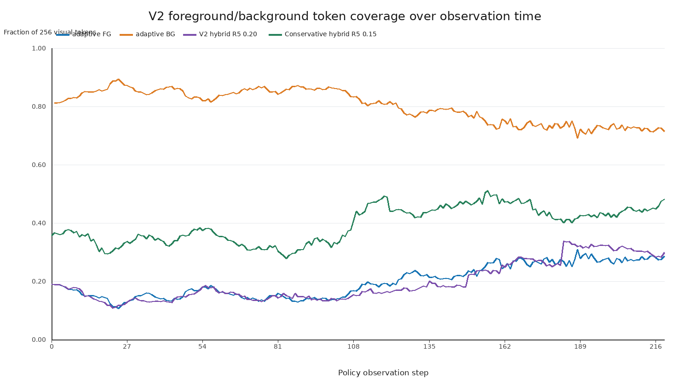
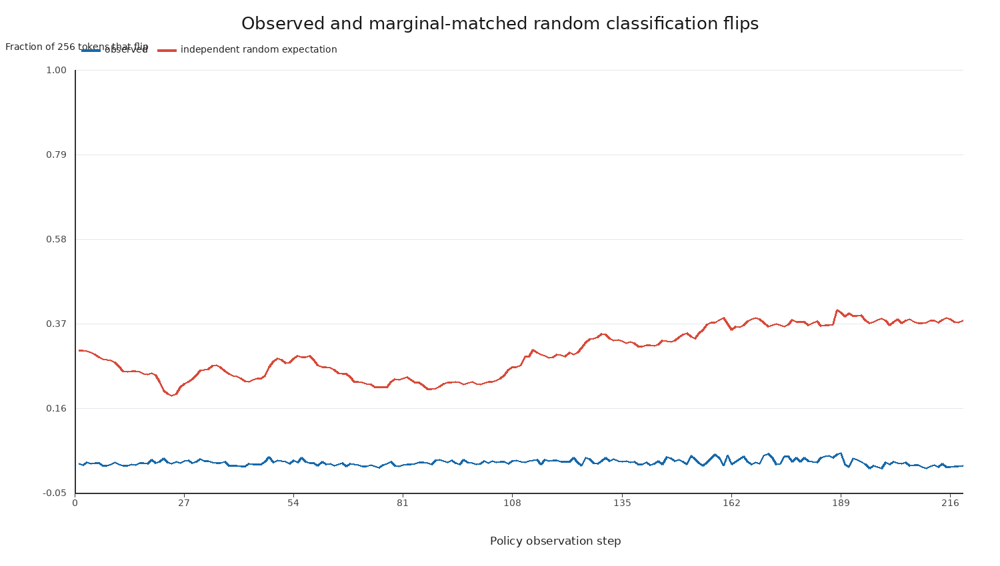
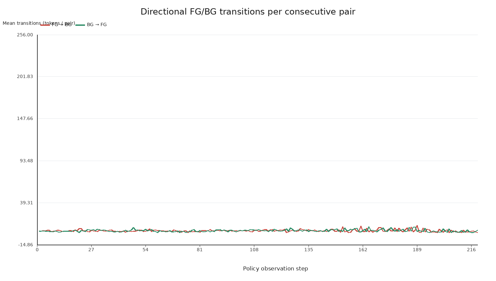
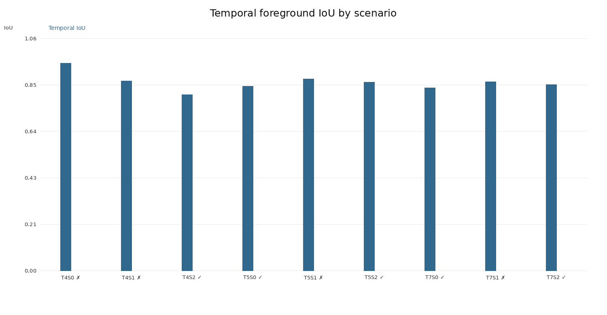
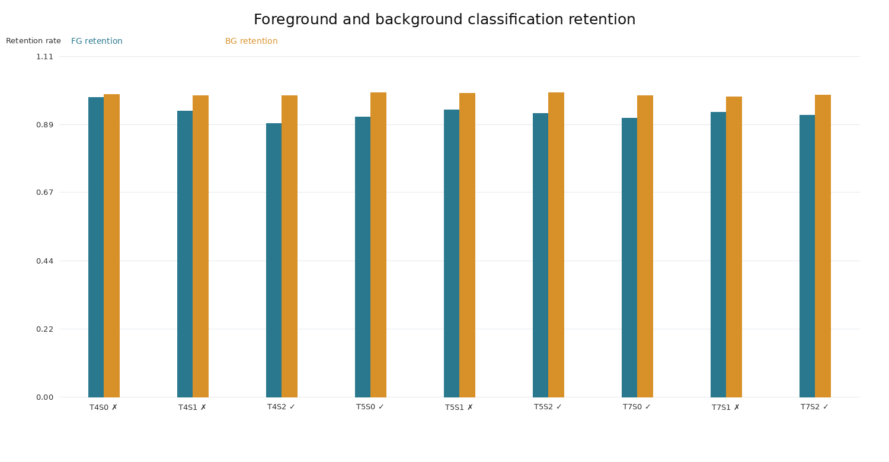
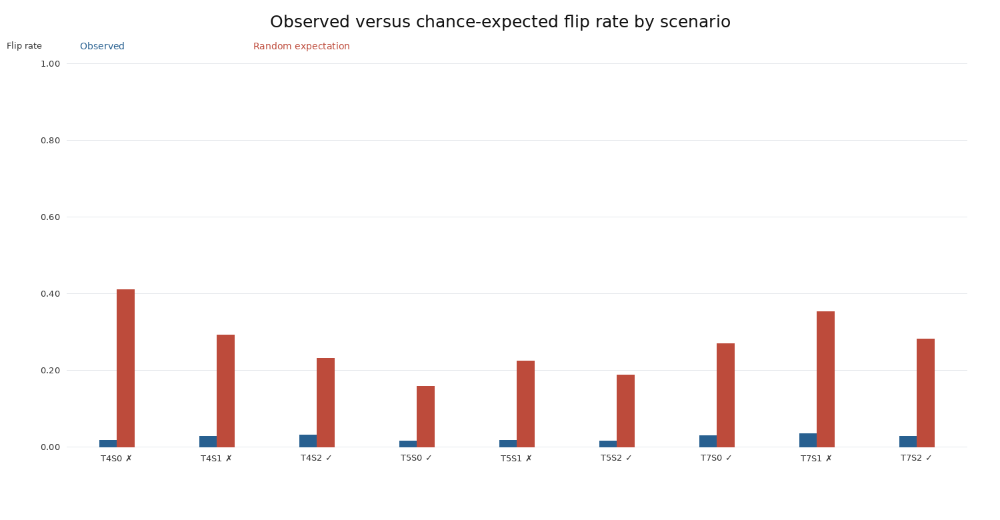

# V2 Temporal FG/BG Classification Consistency Audit

## Summary

The adaptive hybrid trace contains **1,559 decisions** from 9 completed scenarios (5 successes, 4 failures). After excluding the first observation of each scenario, the audit covers **1,550 consecutive pairs**. The V2 classification flips on **2.4%** of token-pair positions; independent random classifications matched to each pair's foreground proportions predict **28.0%**. Marginal-adjusted agreement is **91.5%**.

These are aggregate mask-consistency statistics, not segmentation accuracy or evidence that a stable classification is correct.

## Adaptive Hybrid results

| Metric | Result |
|---|---:|
| Mean FG tokens per observation | 46.8/256 (18.3%) |
| Mean BG tokens per observation | 209.2/256 (81.7%) |
| FG → BG / BG → FG per pair | 4,694 / 4,714 total; 3.03 / 3.04 mean |
| FG → FG / BG → BG per pair | 67,822 / 319,570 total |
| FG retention | 93.5% |
| BG retention | 98.5% |
| Temporal foreground IoU (micro) | 87.8% |
| Expected random flip rate | 28.0% |
| Chance-adjusted agreement | 91.5% |

### Selective versus full-refresh decisions

Transition reconstruction was valid on 1,198 pairs following selective decisions and 352 pairs following full-refresh decisions. In the runner, `transition_protection_count` is computed from the semantic masks before a confidence-triggered full refresh overrides the cache-selection mask. Thus it remains a valid semantic transition count on those refresh pairs, but does not imply that transition protection changed the full-refresh K/V selection. The first frame of each scenario has no predecessor and is excluded.

The semantic FG/BG map is distinct from the actual KV refresh/reuse mask: the adaptive policy unions current FG, lagged attention protection, and FG→BG transitions, and may refresh every token on a confidence trigger. This report audits only semantic classifications.

## Scenario-level results

| Scenario | Outcome | Pairs | FG retention | BG retention | Temporal FG IoU | Observed flips | Random expected | Chance-adjusted agreement |
|---|:---:|---:|---:|---:|---:|---:|---:|---:|
| Task 4 / state 0 | Failure | 219 | 97.6% | 98.7% | 95.1% | 1.6% | 41.0% | 96.1% |
| Task 4 / state 1 | Failure | 219 | 93.2% | 98.3% | 87.0% | 2.7% | 29.2% | 90.9% |
| Task 4 / state 2 | Success | 187 | 89.3% | 98.3% | 80.6% | 3.0% | 23.1% | 87.1% |
| Task 5 / state 0 | Success | 112 | 91.4% | 99.2% | 84.5% | 1.5% | 15.7% | 90.6% |
| Task 5 / state 1 | Failure | 219 | 93.6% | 99.0% | 87.9% | 1.7% | 22.3% | 92.5% |
| Task 5 / state 2 | Success | 110 | 92.5% | 99.2% | 86.3% | 1.6% | 18.6% | 91.6% |
| Task 7 / state 0 | Success | 121 | 90.9% | 98.3% | 83.7% | 2.9% | 26.9% | 89.2% |
| Task 7 / state 1 | Failure | 219 | 92.8% | 97.8% | 86.6% | 3.3% | 35.1% | 90.5% |
| Task 7 / state 2 | Success | 144 | 91.9% | 98.4% | 85.2% | 2.7% | 28.1% | 90.2% |

### Successful versus failed rollout groups

Successful-scenario pairs: observed flips 2.4%, random expectation 22.9%, FG/BG retention 91.0%/98.6%, temporal IoU 83.6%.
Failed-scenario pairs: observed flips 2.3%, random expectation 31.9%, FG/BG retention 94.8%/98.5%, temporal IoU 89.9%.

This grouping is descriptive. With nine scenarios and task-dependent difficulty, it cannot establish that temporal consistency causes success or failure.

## Comparison with the two fixed R5 configurations

The fixed V2 Hybrid R5 @0.20 and Conservative Hybrid R5 @0.15 traces contain per-observation foreground counts, so their mean FG/BG coverage and foreground-count variability can be compared. They did not persist transition counts or complete masks. Therefore, exact transition rates, retention, temporal IoU, random-adjusted agreement, or token-position instability are not comparable and are not inferred.

| Configuration | Success | Mean FG tokens | Mean BG tokens | FG fraction | FG-count SD | Exact temporal transitions |
|---|---:|---:|---:|---:|---:|---|
| Adaptive hybrid 0.20 | 5/9 | 46.8 | 209.2 | 18.3% | 25.1 | available from aggregate transition telemetry |
| V2 hybrid R5 0.20 | 7/9 | 43.0 | 213.0 | 16.8% | 26.1 | unavailable: full masks and FG->BG counts were not persisted |
| Conservative hybrid R5 0.15 | 5/9 | 96.3 | 159.7 | 37.6% | 26.7 | unavailable: full masks and FG->BG counts were not persisted |

## Figures

The time-series charts average scenarios that have an observation at each absolute step. Later points therefore represent the subset of longer-running episodes, not a fixed cohort.

## Data availability and limitations

The saved adaptive telemetry includes `v2_fg_count` and `transition_protection_count` per decision but not a complete binary mask or per-token probability map. The FG→BG count is the runner's `previous_foreground AND NOT current_foreground` transition count. The other three cells are reconstructed exactly from the two aggregate FG counts and this count using the specified equations. Every row was checked for nonnegative entries summing to 256.

Unavailable from these artifacts: per-position persistence/flip frequencies, spatial instability heatmaps, per-token score variance, token-specific FG→BG→FG or BG→FG→BG oscillations. Although per-frame score minima/maxima were saved, these cannot recover token-level continuous-score changes. No missing predictions were regenerated.

Objects can move and produce correct mask changes; consistency alone is not a quality metric. Distinguishing legitimate motion from classifier noise requires full per-frame masks/probability maps aligned to RGB, object/role ground truth or tracks, and synchronized consecutive images. For cache safety it would additionally require linking each reused token to source/current scene content and measuring downstream action/cache error.

## Metric definitions

For each pair, `fg_to_bg` is the logged transition protection count; `bg_to_fg = fg_current - fg_previous + fg_to_bg`; `fg_to_fg = fg_previous - fg_to_bg`; and `bg_to_bg = 256 - fg_previous - bg_to_fg`. Flip rate is `(fg_to_bg + bg_to_fg)/256`. FG/BG retention divide same-class persistence by the corresponding previous-frame class count. Temporal FG IoU is `fg_to_fg / (fg_previous + bg_to_fg)`. The random baseline independently samples each frame with the observed foreground proportion. Chance-adjusted agreement is `(observed agreement − expected random agreement)/(1 − expected random agreement)`, equivalently `1 − observed_flip_rate/expected_random_flip_rate`.

Reproducibility: run `python experiments/kv_cache/experiments/v2_temporal_consistency_audit.py` from the repository root. The analysis is CPU-only and reads completed JSON records; it does not call policy, simulator, CUDA, or model code.
